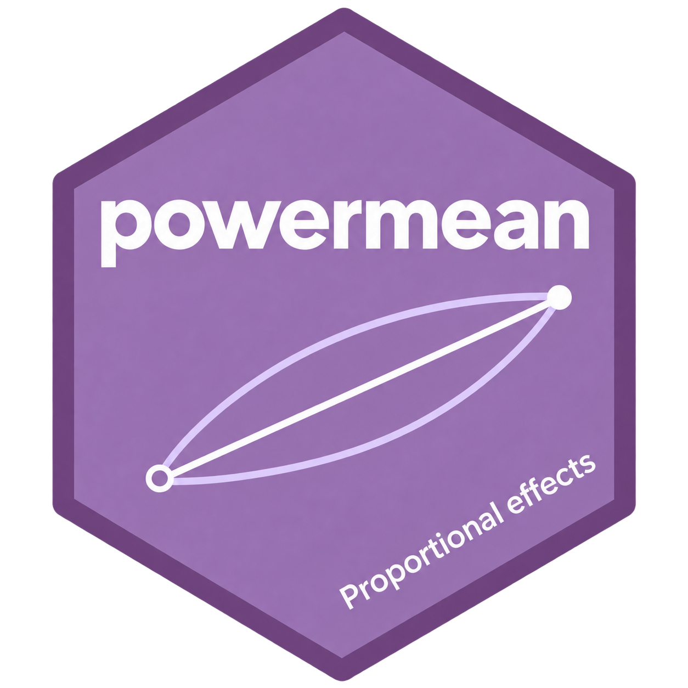

# Powermean for R 

**Powermean is an R package for fitting power-mean regressions and estimating proportional effects.** It implements the framework of Benatia et al. (2026), *Dealing with Logs and Zeros in Regression Models*, including exponential conditional-mean models and log-linear regressions. With `fit()`, choose the conditional mean and the working variance separately, model outcomes in levels with observed zeros, and report proportional effects with confidence intervals. [Paper](https://arxiv.org/abs/2203.11820v4)

Estimate multiple high-dimensional fixed-effect blocks jointly, or cancel a selected block while retaining the others. Powermean provides bias corrections that address the incidental-parameters problem in short panels and three-way gravity models. The same formula interface takes you from a simple conditional-mean regression to three-way gravity and nonlinear difference-in-differences.

[User guide](docs/README.md) · [Function index](docs/reference.md) · [Powermean for Python](https://github.com/dvbn/powermean)

## Installation

Install from GitHub. Building from source requires R’s C++17 toolchain. [Installation and platform requirements](docs/install.md)

```r
if (!requireNamespace("remotes", quietly = TRUE)) install.packages("remotes")
remotes::install_github("dvbn/powermean-R")
```

## A first fit

Suppose `x` is strictly exogenous and the arithmetic conditional mean is $E[Y\mid x]=\exp(\alpha+\beta x)$. Fit that mean by Poisson pseudo-maximum likelihood (PPML). Zero outcomes stay in the fit.

```r
library(powermean)

data <- data.frame(x = c(0, 0, 0, 1, 1, 1), y = c(0, 1, 2, 1, 2, 3))
model <- fit(y ~ x, data, omega = 1, tau = 1)
effect(model, "x", contrast = c(0, 1))
```

The fitted means are 1 at `x = 0` and 2 at `x = 1`. The effect estimate is 1 on the proportion scale: a 100% increase. Keep the mean order at one and change the working variance to compare PPML with an intermediate choice or Gamma PML. [Conditional-mean example](docs/quick-tour.md#1-conditional-mean)

## Gravity

Fit bilateral trade in levels with pair, exporter-year and importer-year fixed effects. Compare joint estimation with cancelling the pair block, and report agreement effects with pair-clustered uncertainty. [Gravity example](docs/quick-tour.md#2-gravity)

## Nonlinear difference-in-differences

Model an outcome such as visits under common or staggered adoption. Under multiplicative parallel trends, estimate proportional effects by adoption cohort and period, with uncertainty clustered by unit. [Nonlinear difference-in-differences example](docs/quick-tour.md#3-nonlinear-difference-in-differences)

## Work with the results

- [Compare estimation samples](docs/examples.md#compare-estimation-samples) before comparing models.
- [Predict, interpret and export results](docs/examples.md#reuse-and-export-a-fit).
- [Build tables](docs/reference.md#tables-and-exports) for several fits or describe your data.

## Citation and license

Cite Benatia et al. (2026) and record your package version. [Papers and methods](docs/README.md#references) · `citation("powermean")`

Powermean’s own source is licensed under [BSD-3-Clause](LICENSE.md). Bundled components carry the [exact-basis notice](inst/LICENSE.K3) and [IOLS notice](inst/LICENSE.K4).
